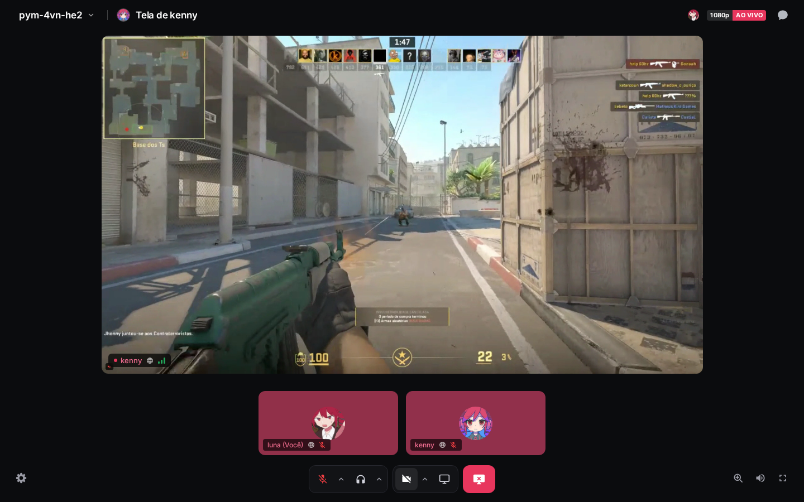
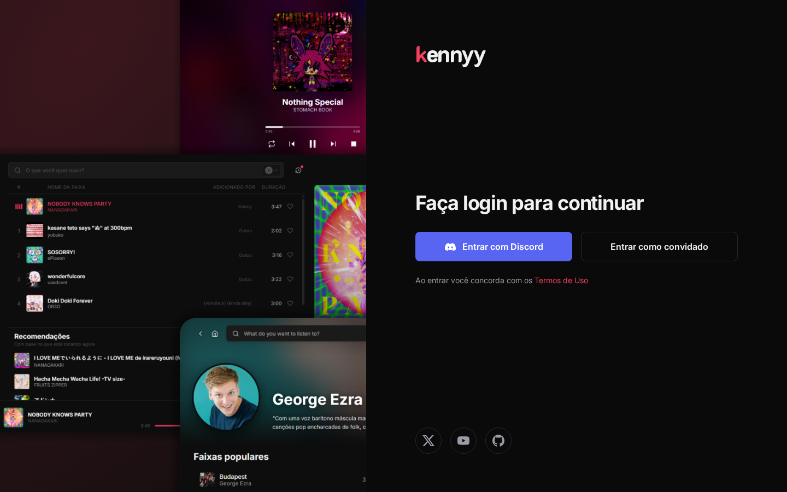
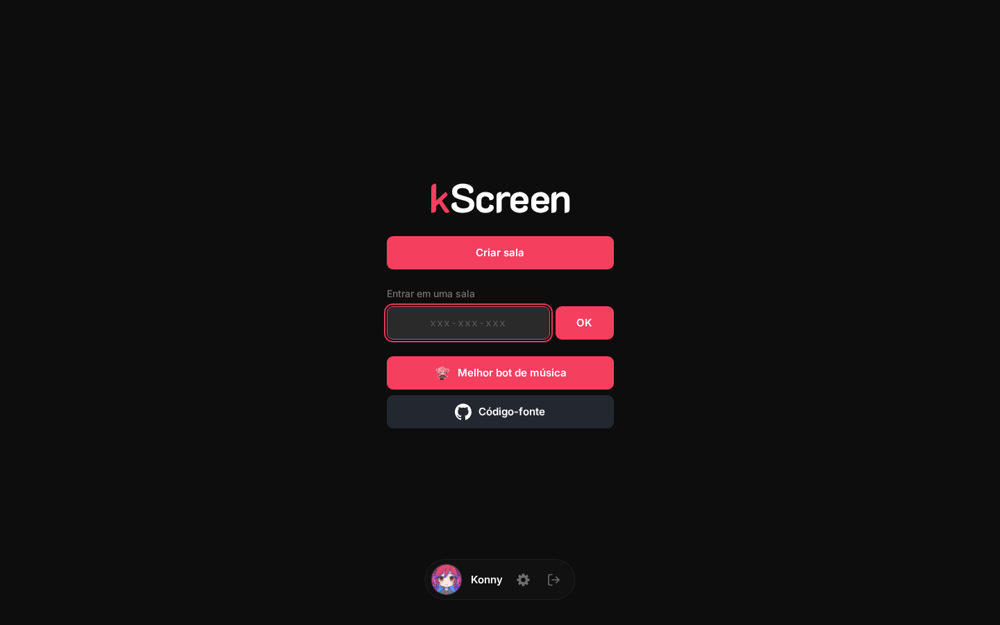
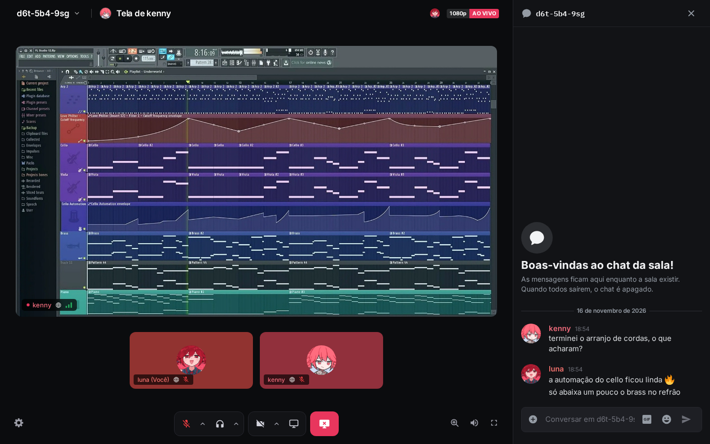
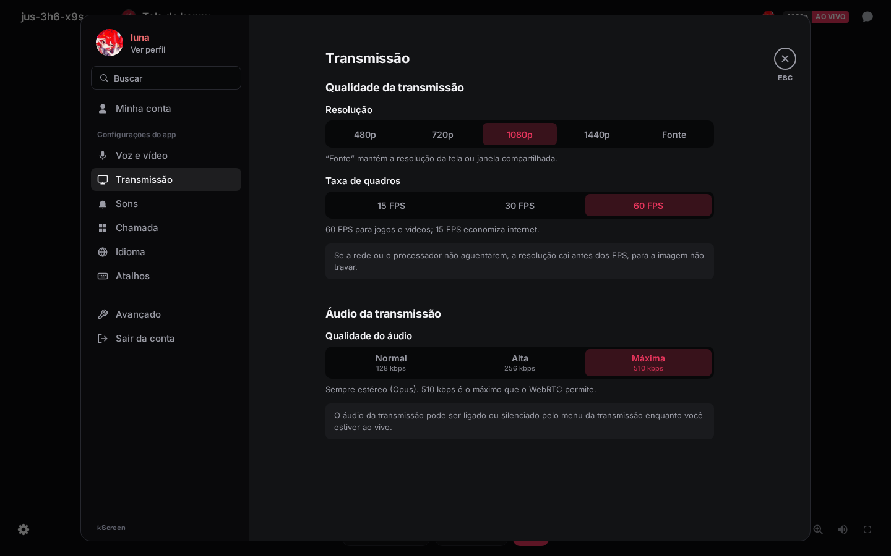

# kScreen

Chamada de voz e compartilhamento de tela entre amigos, direto no navegador. Você cria uma sala,
manda o código pro pessoal e todo mundo pode transmitir a tela ao mesmo tempo, em até 1440p e
60 FPS, com o som do PC junto.

Dá pra usar em [screen.kennyy.com.br](https://screen.kennyy.com.br) ou subir o seu em qualquer
máquina com Node.



## O que tem

- **Salas com código** (`abc-def-ghi`), com senha e limite de pessoas opcionais.
- **Várias telas ao mesmo tempo.** Cada um escolhe qual transmissão quer assistir, em grade ou
  em destaque, e pode abrir qualquer uma numa janela separada.
- **Qualidade ajustável:** 480p até 1440p (ou a resolução original), 15/30/60 FPS e áudio da
  transmissão em até 510 kbps estéreo.
- **Voz com supressão de ruído** (RNNoise rodando no navegador) e cancelamento de eco.
- **Chat da sala** com respostas, emojis, GIFs e imagens. As imagens passam de pessoa pra pessoa
  pela própria conexão da chamada; o servidor nunca guarda o arquivo.
- **Login com Discord ou como convidado**, com foto e cor de perfil.
- **Português e inglês**, seguindo o idioma do sistema.
- **App para Windows e Linux** (Electron), que captura todo o som do PC sem eco das vozes da sala
  e deixa excluir apps do áudio (ex.: não transmitir o próprio Discord).

| | |
|---|---|
|  |  |
|  |  |

## Como funciona

A mídia vai direto de uma pessoa pra outra (WebRTC P2P). O servidor só faz o login, a sinalização
e o chat; ele não vê nem retransmite vídeo.

Salas grandes, ou com alguém que não consegue conexão direta (4G/5G, NAT simétrico), podem passar
por um servidor de mídia [LiveKit](https://livekit.io/). Isso é opcional: sem LiveKit configurado,
tudo fica em P2P.

## Rodando localmente

Precisa de Node 20.19 ou mais novo.

```bash
git clone https://github.com/konnyoung/kscreen.git
```

```bash
cd kscreen && npm install
```

```bash
cp .env.example .env.local
```

Para testar sozinho não precisa preencher nada: dá pra entrar como convidado. O login com
Discord só aparece funcionando depois de colocar `DISCORD_CLIENT_ID` e `DISCORD_CLIENT_SECRET`
(crie um app em [discord.com/developers](https://discord.com/developers/applications) e adicione
`http://localhost:5173/api/auth/discord/callback` como redirect).

```bash
KSS_HTTPS=0 npm run dev
```

Abra `http://localhost:5173`, crie uma sala e abra o mesmo link em outra aba ou outro navegador
pra ter alguém do outro lado.

Sem `KSS_HTTPS=0` o Vite sobe em HTTPS com um certificado autoassinado, útil pra testar de outro
aparelho na rede (o navegador só libera câmera, microfone e captura de tela em HTTPS ou localhost).

### Variáveis do `.env.local`

| Variável | Pra quê |
|---|---|
| `SESSION_SECRET` | Assina o cookie de login. Sem ela, todo mundo é deslogado quando o servidor reinicia. Gere com `openssl rand -hex 32`. |
| `DISCORD_CLIENT_ID`, `DISCORD_CLIENT_SECRET` | Login com Discord. |
| `DISCORD_BOT_TOKEN` | Opcional. Token do bot do mesmo app do Discord (aba **Bot**; não precisa estar em nenhum servidor). Com ele, quem troca a foto no Discord aparece com a foto nova no kScreen. |
| `PUBLIC_URL` | Endereço público em produção (usado no redirect do Discord). |
| `ADMIN_IDS` | IDs do Discord que podem abrir o painel admin. Vazio, ninguém abre. |
| `GIPHY_API_KEY` | Busca de GIFs no chat. Chave grátis em [developers.giphy.com](https://developers.giphy.com/). |
| `LIVEKIT_URL`, `LIVEKIT_API_KEY`, `LIVEKIT_API_SECRET` | Servidor de mídia opcional. Também dá pra cadastrar nós pelo painel admin. |
| `KSCREEN_DATA_DIR` | Onde ficam os dados do servidor (padrão `~/.kscreen`). |

## Colocando no ar

```bash
npm run build && npm run preview -- --host 127.0.0.1 --port 4173
```

O `vite preview` serve o site e a API juntos. Na frente dele, um nginx (ou Caddy) com HTTPS e
`PUBLIC_URL` apontando pro seu domínio. Coloque o domínio em `allowedHosts` no
`vite.config.js`.

## App desktop

Fica em [`desktop/`](desktop/). Ele abre o site numa janela própria e adiciona o que o navegador
não deixa fazer: seletor de telas com prévia, som do PC sem eco, captura de jogos em tela cheia
pela GPU e links `kscreen://`. Detalhes de build e de cada sistema no
[README do app](desktop/README.md).

```bash
cd desktop && npm install && npm run dev
```

## Licença

[GPL-3.0](LICENSE). Pode usar, modificar e hospedar; se distribuir uma versão modificada, o código
dela também tem que ser aberto.
